# Solar Voyager

**Fly a spaceship through a true-scale, real-time Solar System, and on out to the nebulae and galaxies beyond it, right in your browser.**

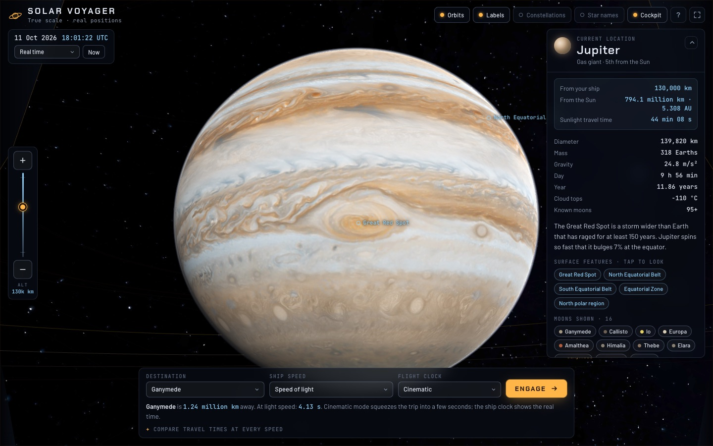

Solar Voyager is a full-page 3D app built on [three.js](https://threejs.org). Pick a destination, pick a speed (walking pace, the speed of sound, Voyager 1, the speed of light), then press **Engage**. The planets sit where they really are today. Every world is drawn at its real size and distance, and you can zoom from deep space down to a few kilometres above Jupiter's clouds or the Moon's craters.

There is no build step, framework or backend. You need a static file server and a browser with WebGL 2.

### Highlights

- **True scale.** 1 unit = 1 km. Distances and sizes are real, so most worlds are dots until you get close, the same as from a real spacecraft.
- **Real positions and lighting.** Planets follow JPL orbital elements for the current date. Earth's day side, the Moon's phase and the angle of Saturn's rings match the real sky.
- **75 bodies.** The Sun, 8 planets, Pluto and 65 moons, each with its real radius, colour, orbit size and period. Irregular moons such as Phobos and Hyperion are lumpy, not spheres.
- **Detail that keeps coming as you zoom.** Sharper textures stream in as you approach. Procedural detail adds finer structure past the texture's resolution: cloud eddies on Jupiter, ringlets in Saturn's rings, craters on the Moon.
- **A real sky.** A Milky Way panorama aligned to galactic coordinates, 197 bright stars at catalogue positions and colours, 25 constellation figures, and star names.
- **Speed you can feel.** Flights at a choice of ten speeds. A ship clock shows the true trip time: 1.3 s from Earth to the Moon at light speed, or 413 years to Neptune at the speed of sound.
- **Eclipses and shadows.** Moons cast shadows on planets, planets eclipse their moons, Saturn's rings shadow the planet, and the planet shadows its rings.
- **Posters of any date.** A birthday, a wedding, the day you met: the poster studio draws every planet where it really was, rendered by the 3D engine and lit by the Sun, plus that night's Moon phase, ready to print at 18 × 24 in. An optional deep-sky background puts the real Milky Way, bright stars and nebulae behind it, projected so the ecliptic lands on the poster's constellation ring.
- **Spacetime curvature.** One toggle shows general relativity at work: a grid that sinks into each world's gravity well, shaped by its real mass, and starlight bending around planets into Einstein rings.
- **Galaxies and nebulae you can fly to.** 20 deep-sky objects, built as 3D volumes of glowing gas and dust at their real positions, distances and sizes: the Andromeda, Triangulum, Whirlpool, Sombrero and Cigar galaxies, Messier 87, Centaurus A, the Large Magellanic Cloud and our own Milky Way seen from outside; the Orion, Eagle, Lagoon, Carina, Crab, Ring, Helix, Horsehead and Veil nebulae; the Pleiades and Omega Centauri. Nebulae glow in the colours of their emission lines, dust lanes and pillars stand in silhouette, fine wisps and filaments stay sharp as you fly in, and each object has highlights to fly in close to, such as the Pillars of Creation.

---

## Contents

1. [Quick start](#1-quick-start)
2. [Your first flight, step by step](#2-your-first-flight-step-by-step)
3. [Controls](#3-controls)
4. [Gallery](#4-gallery)
5. [How it works: the big picture](#5-how-it-works-the-big-picture)
6. [Units, coordinates and the precision problem](#6-units-coordinates-and-the-precision-problem)
7. [Where everything is: orbits and rotation](#7-where-everything-is-orbits-and-rotation)
8. [How the sky is built](#8-how-the-sky-is-built)
9. [How the sky objects are built](#9-how-the-sky-objects-are-built)
10. [How zooming works](#10-how-zooming-works)
11. [How lighting works](#11-how-lighting-works)
12. [How spacetime curvature works](#12-how-spacetime-curvature-works)
13. [How flights work](#13-how-flights-work)
14. [What is real and what is approximated](#14-what-is-real-and-what-is-approximated)
15. [Project structure](#15-project-structure)
16. [Extending it](#16-extending-it)
17. [Browser support and performance](#17-browser-support-and-performance)
18. [Credits](#18-credits)

---

## 1. Quick start

**Step 1: Get the code.** Clone or download this repository and open a terminal in its folder.

**Step 2: Serve the folder over HTTP.** Browsers refuse to load WebGL textures from pages opened straight from disk (`file://`), so start any static server:

```bash
# Python 3 (preinstalled on macOS and most Linux distributions)
python3 -m http.server 8000

# or Node.js
npx serve .
```

In VS Code, the *Live Server* extension also works.

**Step 3: Open the app.** Go to <http://localhost:8000>. A loading screen fetches the first set of planet maps (about 7 MB) and then drops you into orbit around Earth.

> The 3D library (three.js r160) loads from the jsDelivr CDN through an import map in `index.html`, so the first visit needs an internet connection. If you open `index.html` directly from disk, the loading screen explains how to serve it instead.

---

## 2. Your first flight, step by step

1. **Look around.** You start about 16,000 km above Earth's sunlit side. Drag to orbit the planet and scroll to zoom. The day and night sides match the real time: the city lights on the night side belong to the people who are in darkness right now.
2. **Read the info panel.** The panel on the right describes the body you are at: live distance from your ship and from the Sun, how long sunlight takes to arrive, physical facts, and a list of surface features.
3. **Tap a surface feature.** Choose *Amazon rainforest* or *Mount Everest*. The camera swings over that spot. If the feature is on the night side, the app says so and suggests speeding up the clock.
4. **Pick a destination.** Use the *Destination* menu in the flight console at the bottom, or tap any planet, moon or label in the view. Jupiter is pre-selected.
5. **Pick a speed.** The *Ship speed* menu runs from walking pace to a sci-fi warp drive. The line under the console shows the distance and trip time at that speed. Open *Compare travel times at every speed* to see all of them side by side.
6. **Pick a flight clock.**
   - **Cinematic** squeezes any trip into a few seconds (about 4 to 11). The ship clock still shows the real elapsed time at your chosen speed.
   - **Real time** flies at the true speed. At light speed, Earth to the Moon takes 1.3 real seconds and Earth to Mars takes several minutes. The ×100 to ×1 million options speed that up.
7. **Press Engage.** The flight display shows the ship clock, time left, distance left and velocity. Press **Esc** or **Abort** to stop wherever you are.
8. **Explore on arrival.** You arrive on the sunlit side and the console suggests the next stop, usually the largest moon. Use the zoom buttons on the left edge to dive towards the clouds.
9. **Play with time.** The clock in the top left shows the simulated date in your own time zone (hover over it for UTC) and can run at up to one year per second. Watch Io whip around Jupiter, the Great Red Spot rotate into daylight, or a moon slide out of its planet's shadow. **Now** jumps back to the present.
10. **Switch on the sky overlays.** The buttons at the top right toggle orbits, labels, constellation figures, star names, spacetime curvature and the cockpit frame. They live in the **View** dropdown, grouped by Solar System, Sky, Physics and Display. The eye button (or **H**) hides every control when you just want to look. A small dock stays at the bottom with your destination, so you can still check details or press Engage without bringing everything back.

---

## 3. Controls

| Input | Action |
| --- | --- |
| Drag (mouse or one finger) | Orbit the current body |
| Scroll wheel / pinch | Zoom from deep space down to the surface |
| **+** / **−** buttons (left edge) | Zoom one step; hold to keep zooming |
| Zoom slider (left edge) | Jump to any altitude; top is the surface, bottom is deep space |
| Right-drag, or Shift + drag | Look around the cockpit without moving the ship |
| Tap a body, galaxy, nebula or label | Set it as the destination |
| Double-tap a body or label | Fly there straight away |
| Arrow keys / A, D | Orbit from the keyboard |
| W / S, + / − keys | Zoom from the keyboard |
| R | Re-centre the view after looking around |
| B, or the **Deep sky** button | Hide the Milky Way and background stars to see only the Sun, planets and moons against black space |
| N, or the **Galaxies & nebulae** button | Show or hide the 3D galaxies, nebulae and star clusters and their labels (the one you are visiting stays) |
| G | Show or hide spacetime curvature (same as the **Curvature** button) |
| **Guided tour** (first launch, or Help › Take the guided tour, or View › Guided tour) | A one-minute walkthrough that does each step for real: a finger drags, pinches and taps while the camera moves, the Moon becomes your destination and the ship flies there; then it asks you to try, and moves on when you do. Esc ends it |
| P, or the **Poster** button | Open the poster studio: the solar system on any date from 1800 to 2050, as a print-ready PNG (link straight to it with `#poster`) |
| H, or the eye button (top right) | Hide every control for a clear, full-screen view; press again, or tap the small eye, to bring them back |
| Dock (bottom, while controls are hidden) | Shows where you're headed and the trip time. Its icons open the details, open the flight controls (the flight readout while flying), and Engage or abort in one tap. On a phone, tap empty space to put panels away |
| **Bottom sheet** (phones) | Like a maps app. Collapsed it shows where you're headed and a **Fly** button; drag it up (or tap the header) for search, every world as a tappable chip, ship speed and flight clock; pull it all the way up for the selected world's details, the clock and the poster studio. Flick to throw it between stops; pull down at the top to collapse. The view slides up to keep the world centred above it. In landscape it floats on the left |
| **Layers** button (phones, top right) | Opens the display options as a sheet from the bottom. Under it, the eye hides everything for a clear view |
| **View** button (top right) | Opens the display options, grouped: orbits and labels, deep sky, galaxies and nebulae, constellations and star names, curvature, cockpit, and the **Details** and **Flight console** panels. The badge counts what is on. On phones it also holds Poster, Help and Full screen |
| × on a panel | Closes the Details panel or the Flight console and switches it off under View. While the console is closed, a small dock at the bottom keeps the destination, trip time and Engage one tap away |
| Space | Pause or resume time |
| Enter | Engage (when nothing else has focus) |
| Esc | Abort a flight, or close the help screen |

On phones the zoom control moves to the right edge and shows only the buttons. The details panel starts collapsed.

---

## 4. Gallery

| | |
| --- | --- |
| 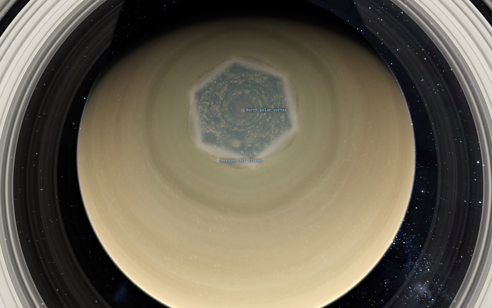 | 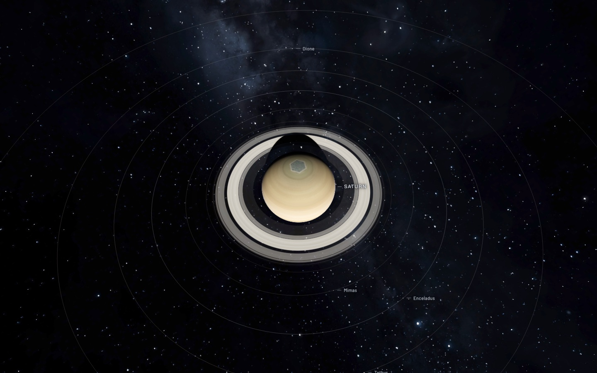 |
| Saturn's north-polar hexagon and vortex (clock set to June 2017, northern summer) | Saturn from 600,000 km: Cassini Division, the planet's shadow across the rings, and moon orbits |
| 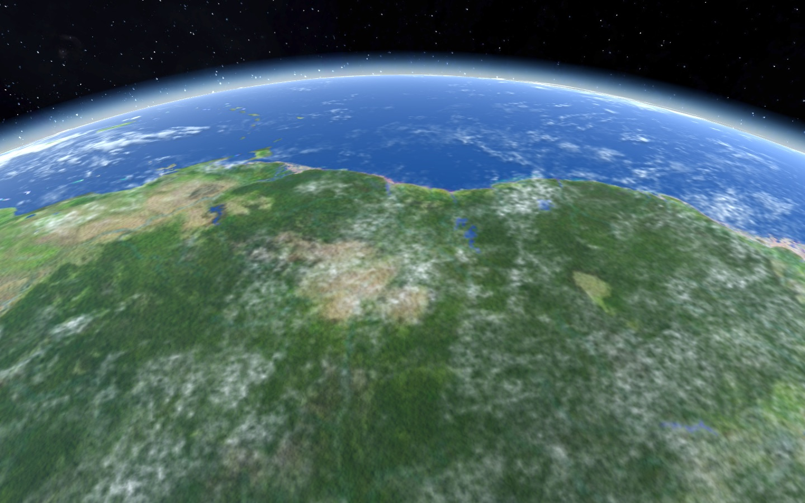 | 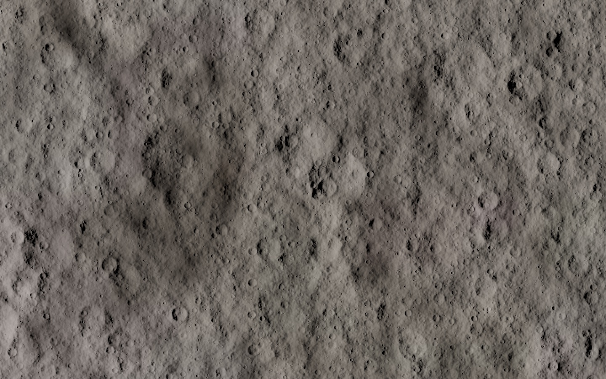 |
| Looking along Earth's horizon from 900 km over the Amazon | The Moon from 60 km: texture plus procedural craters and relief |
| 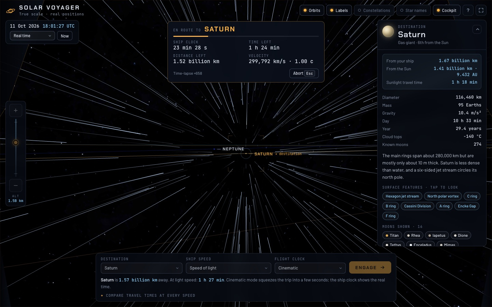 | 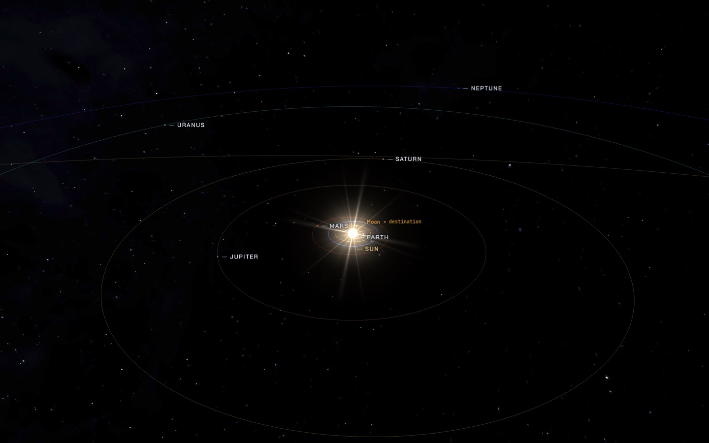 |
| En route to Saturn at light speed (×658 time-lapse) | Pulled back to 3 billion km above Earth: real planetary positions on 11 October 2026 |
| 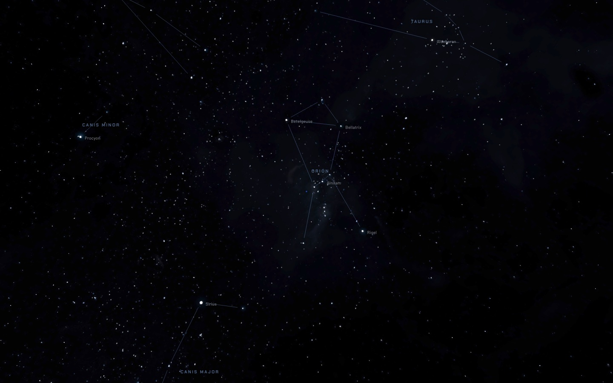 |  |
| Constellations and star names over the Milky Way: Orion, Taurus, Canis Major and Minor | The cockpit interface at Jupiter |
| 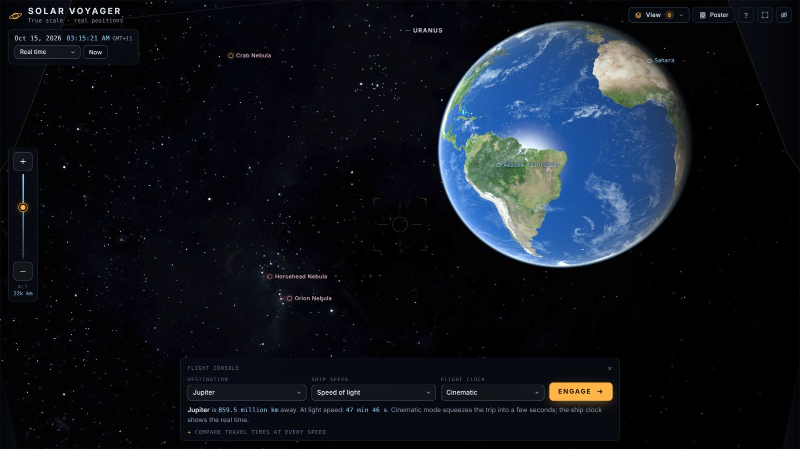 | 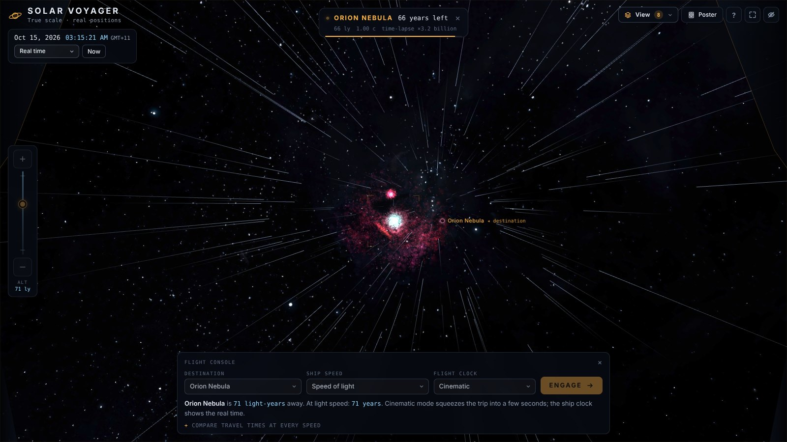 |
| From near Earth: the Orion Nebula, Horsehead and Crab Nebula sit at their real places on the sky | Leaving the Solar System for the Orion Nebula at light speed, 1,344 light-years away |
| 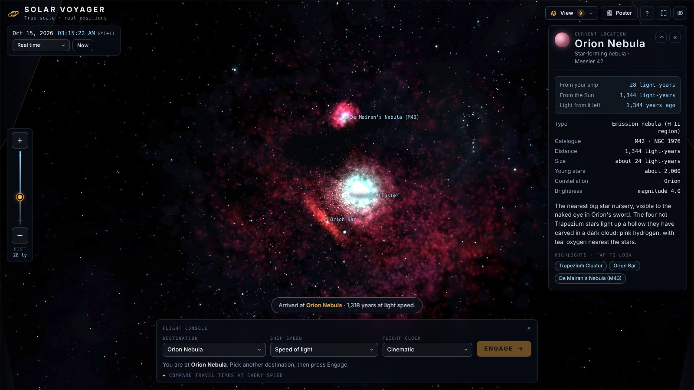 | 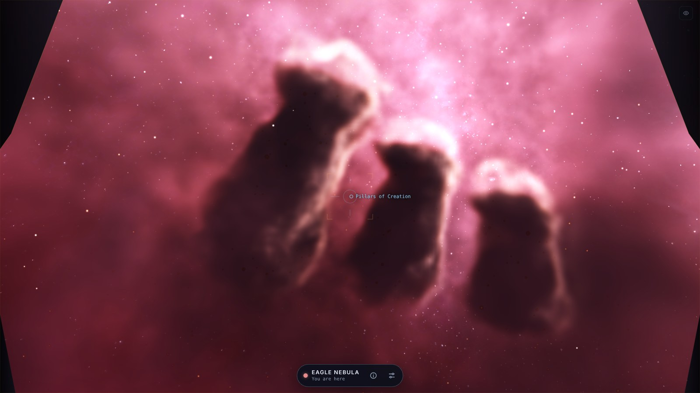 |
| The Orion Nebula: teal oxygen glow round the Trapezium stars, pink hydrogen, the dark bay and M43 | Flown in close to the Pillars of Creation, dark columns against the glowing Eagle Nebula |
| 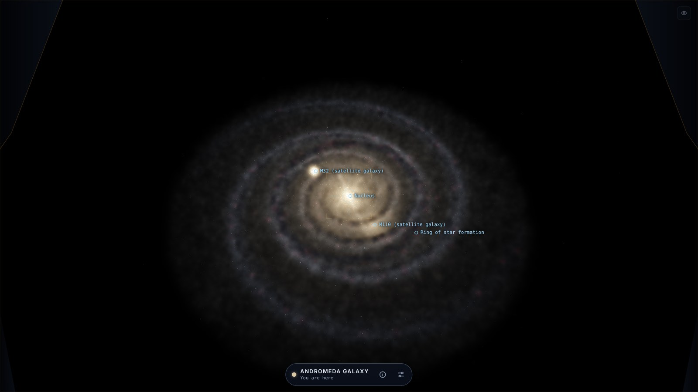 | 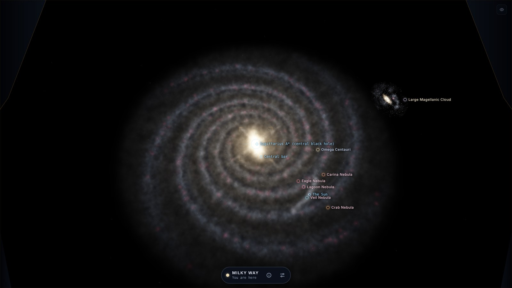 |
| The Andromeda Galaxy, 2.5 million light-years out, with its satellites M32 and M110 | Our Milky Way from 120,000 light-years above the disc, with the nebulae of its arms and the Large Magellanic Cloud |

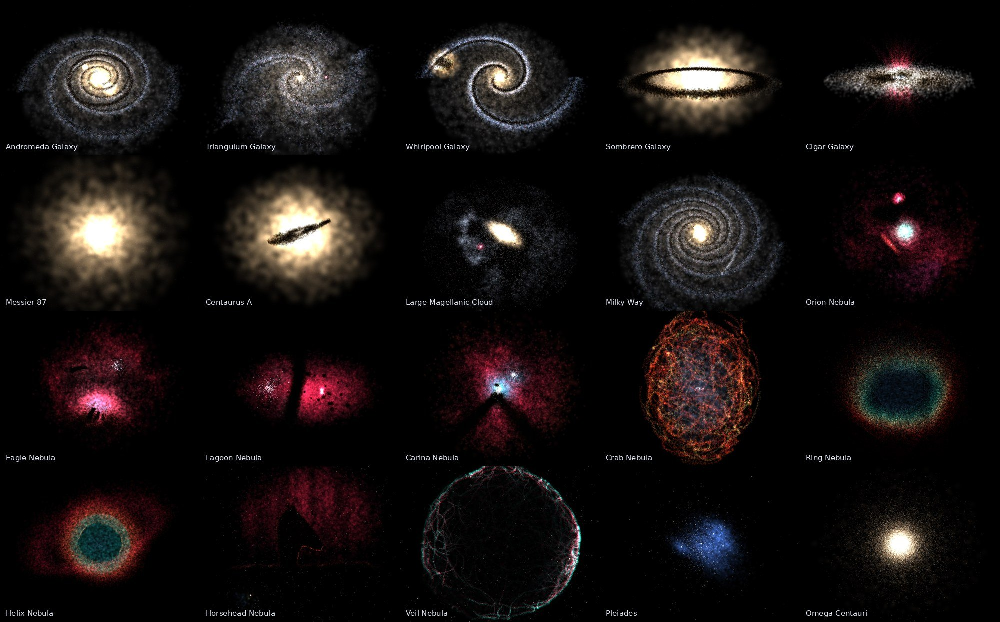

*Every galaxy, nebula and cluster you can fly to, drawn by the same 3D models.*

---

## 5. How it works: the big picture

Every frame runs the same pipeline (`js/main.js`):

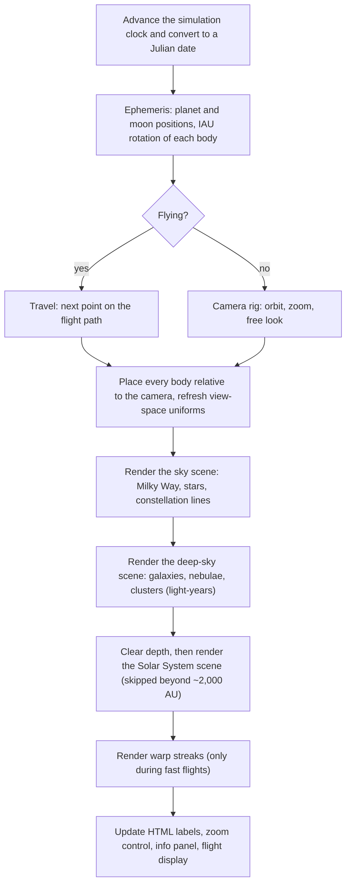

Step by step:

1. **Clock.** `simMs` (milliseconds since 1970) advances by the frame time multiplied by the chosen rate, from 0 for paused up to 31,557,600 for one year per second. It becomes a Julian date: `jd = ms / 86,400,000 + 2,440,587.5`.
2. **Ephemeris.** `SolarSystem.update(jd)` computes the position and orientation of all 75 bodies (section 7).
3. **Camera.** Either the flight controller (`Travel`) or the orbit controller (`CameraRig`) decides where the ship is and which way it faces.
4. **Camera-relative placement.** `SolarSystem.updateRender()` subtracts the ship's position from every body's position in 64-bit JavaScript numbers before anything reaches the GPU (section 6). It also projects each body to the screen for labels and picking, and fills in the shader inputs: the Sun's direction, eclipse casters and ring geometry.
5. **Render.** Three scenes are drawn back to back. The sky first, then the galaxies, nebulae and star clusters, then, after clearing the depth buffer, the planets, moons, rings, atmospheres, orbit lines and glare.
6. **Interface.** Labels are plain HTML elements, positioned every frame from the screen projections computed in step 4.

---

## 6. Units, coordinates and the precision problem

### One unit is one kilometre

The scene uses kilometres throughout, with the Sun at the origin. The axes follow the ecliptic, the plane of Earth's orbit:

| Scene axis | Points towards |
| --- | --- |
| `+x` | The March equinox (ecliptic longitude 0°) |
| `+y` | Ecliptic north |
| `−z` | Ecliptic longitude 90° |

`js/ephemeris.js` has small helpers to convert between this frame, the equatorial frame that star catalogues and planet poles use, and the galactic frame the Milky Way panorama uses.

### Problem 1: float precision

Neptune is about 4.5 billion km from the Sun. GPUs work in 32-bit floats, which hold about 7 significant digits, so a position near Neptune can only be stored to the nearest few hundred kilometres. Fly close to Neptune's 20 km moon Naiad and it would jitter wildly.

**The fix is camera-relative rendering.** The camera always sits at the origin of the GPU scene. Every frame, each body's true position (a 64-bit `Vector3` in kilometres) minus the ship's true position becomes the mesh's position. Nearby objects end up with small coordinates and keep full precision. Far objects have large coordinates, but there the error is far smaller than a pixel.

The same idea appears inside the shaders. The atmosphere ray marcher, for example, works in the planet's local *unit-sphere* space. The CPU transforms the camera position into that space in double precision, so the shader never subtracts two huge numbers.

### Problem 2: depth range

The camera's near plane is 1 metre and its far plane is 10¹³ km. A normal depth buffer cannot cover 16 orders of magnitude, so distant objects would flicker through each other ("z-fighting").

**The fix is a logarithmic depth buffer** (`logarithmicDepthBuffer: true`). Each fragment writes a depth proportional to `log2(1 + distance)`, which gives roughly constant *relative* precision at every distance. Every depth-tested custom shader includes three.js's `logdepthbuf` chunks so it plays along.

### Problem 3: a sky at infinity

Stars are effectively infinitely far away. They live in a separate `Sky` scene with its own camera, which copies only the main camera's rotation, never its position. That scene is drawn first. The depth buffer is then cleared and the Solar System is drawn on top, so planets always cover the stars behind them.

---

## 7. Where everything is: orbits and rotation

### Planets and Pluto

`planetPosition()` uses JPL's *Keplerian Elements for Approximate Positions of the Major Planets* (valid 1800–2050). For each planet the table gives six orbital elements at the J2000 epoch plus their rates of change per century:

1. Evaluate the elements at the current time: `T = (jd − 2451545) / 36525` centuries.
2. Mean anomaly `M = L − ϖ`, the mean longitude minus the longitude of perihelion.
3. Solve **Kepler's equation** `M = E − e·sin E` for the eccentric anomaly `E` by Newton iteration.
4. Position in the orbital plane: `x′ = a(cos E − e)`, `y′ = a·√(1−e²)·sin E`.
5. Rotate by argument of perihelion ω, inclination I and ascending node Ω into ecliptic coordinates, then convert AU to km.

The same function, sampled around the full orbit (1,440 points), draws the orbit lines.

### Earth and the Moon

JPL's "Earth" entry is really the **Earth–Moon barycentre**. The Moon's position comes from a short lunar series in `moonGeocentric()`: the main periodic terms for longitude, latitude and distance, accurate to a few tenths of a degree. That puts Earth at `barycentre − Moon × 0.01215` (the Moon's share of the combined mass) and the Moon at `Earth + Moon offset`. The Moon's phase as seen from Earth is therefore correct for any date.

### Other moons

Every other moon follows a Keplerian orbit using its real semi-major axis, period, eccentricity and inclination from `js/data.js`:

- **Regular moons** orbit in their planet's equatorial plane. Uranus's moons therefore circle a planet tipped 98° on its side.
- **Irregular, captured moons** (Himalia, Phoebe, Sycorax, Nereid and others) are referenced to the ecliptic. Retrograde orbits simply have inclinations above 90°.
- The node and starting phase of each orbit are fixed values derived from a hash of the moon's name, so they stay the same every visit. They are illustrative, not ephemeris-accurate (section 14).
- Nereid's highly eccentric orbit (e = 0.75) is solved with Kepler's equation like the planets.

### Rotation: which side faces you

Each planet uses its **IAU rotation model**: a north pole direction (right ascension α₀, declination δ₀) and a prime-meridian angle that grows linearly with time, `W = W₀ + Ẇ·d`. `bodyQuaternion()` builds the body's orientation from them:

```
P = pole vector (from α₀, δ₀)
Q = node: where the body's equator crosses Earth's equator
M = Q·cos W + (P × Q)·sin W      → direction of longitude 0°
local +X = M,  local +Y = P,  local +Z = M × P
```

Textures follow the same convention: the centre of each map (`u = 0.5`) is longitude 0° and east increases with `u`. With Earth's IAU values, the Greenwich meridian faces the Sun at noon UTC, which is why the day side is correct.

**Tidally locked moons** (most of them) are oriented so their local +X axis points at the parent planet, which keeps the same face towards it. The Moon uses its IAU pole for its spin axis. Pluto and Charon are locked to *each other*. Chaotic or non-synchronous moons (Hyperion, Phoebe, Nereid) simply spin at their measured rates.

---

## 8. How the sky is built

The sky has three layers in the `Sky` scene (`js/sky.js`), and a fourth, the galaxies and nebulae, in a scene of its own (`js/deepsky.js`).

### Layer 1: the Milky Way panorama

The background is an 8k panorama of the Milky Way (2k on first load, then upgraded). Panoramas like this are usually stored in **galactic coordinates**, but the orientation is rarely documented, so it was measured. I projected the 20 brightest stars into the image under each of the four possible orientations and sampled the pixels there. Only one orientation put all 20 stars on near-white pixels: galactic longitude increasing to the left, galactic latitude increasing *downwards*.

A full-screen sky sphere is drawn with a custom shader (`SKY_FRAG`). For each pixel:

1. Take the view direction in scene coordinates.
2. Rotate it to galactic coordinates with one precomputed 3×3 matrix, `sceneToGalacticMatrix()`, which chains *scene → ecliptic → equatorial* (tilt ε = 23.4393°) *→ galactic* (the standard IAU J2000 matrix).
3. Convert to longitude `l` and latitude `b`, then to texture coordinates:

   ```
   u = fract(0.5 − l / 2π)
   v = 0.5 − b / π
   ```

4. Sample with `textureGrad`, correcting the derivative where `u` wraps from 1 back to 0. Without that correction the GPU would pick the blurriest mip level along the seam and draw a visible line.

The sky sphere's vertices are pushed to the far plane (`gl_Position = p.xyww`), so it never clips no matter how the camera moves.

### Layer 2: bright stars

`js/stars.js` holds 197 bright stars with J2000 right ascension, declination, visual magnitude and **B−V colour index**:

- **Position:** RA/Dec → unit vector in the equatorial frame → scene frame. The stars land exactly on top of the same stars in the panorama.
- **Size:** `size = clamp(6.2 − 1.45 × magnitude, 1.6, 10)` pixels. Sirius (−1.46) gets the full 10 px; a 4th-magnitude star gets about 1.6 px.
- **Colour:** B−V is mapped through a small blackbody-like gradient. Negative values (hot blue-white stars like Rigel) come out blue-white and values near 1.8 (cool red giants like Betelgeuse and Antares) come out orange.
- **Shape:** each point sprite is a sharp core plus a soft halo (`STAR_FRAG`), drawn with additive blending.

### Layer 3: constellations and names

- Each of the 25 constellations is a list of **polylines through named stars**, for example Orion's belt `Alnitak → Alnilam → Mintaka`. They become one `LineSegments` object.
- Each segment is trimmed slightly at both ends so lines stop short of the star discs, the way printed star charts draw them.
- Constellation names sit at the average direction of their stars. Star names cover the 30 brightest and best-known stars.
- Both kinds of name are HTML labels. They hide when a planet's disc or the Sun's glare is in front of them, because a label floating over Jupiter would look wrong.

The sky is fixed to the stars, not to the Solar System, so the constellations look the same from anywhere in the system. That is true in reality too: the nearest star is about 7,000 times farther away than Neptune.

### Layer 4: galaxies, nebulae and star clusters

Twenty deep-sky objects (`js/deepsky-data.js`) are real places you can fly to, not pictures on the sky sphere. Each has its J2000 position, distance, physical size and, for disc galaxies, the position angle and inclination of its disc, so it sits in 3D exactly where it is, at its true size, and tilted the way we see it. From Earth they appear at their catalogue positions on top of the same smudges in the Milky Way panorama.

**One scene in light-years.** Positions stay in kilometres from the Sun in 64-bit numbers, like the planets. Each frame `DeepSky.update()` subtracts the ship's position and divides by a light-year, so the GPU sees the Orion Nebula 1,344 units away rather than 1.3 × 10¹⁶ km. The objects get their own camera (same orientation and field of view as the cockpit) and draw between the sky and the Solar System.

**Models built from particles.** `js/deepsky-models.js` builds each object procedurally from a seeded random generator as three sets of soft particles: glow (gas and unresolved starlight), dust and stars. Shapes follow the real objects: logarithmic spiral arms with dust on their inner edges and pink star-forming knots along them (Andromeda's ring of star formation, the Whirlpool's arm reaching its companion NGC 5195, Triangulum's patchy arms and NGC 604), Hernquist-profile bulges and elliptical galaxies, a dusty ring for the Sombrero, a red superwind for the Cigar Galaxy, the jet of M87, the warped dust band of Centaurus A, the Orion Nebula's bowl-shaped cavity opening towards us, pillars that are dark inside, with a bright skin of ionised gas on the heads and edges that face their star cluster, the Horsehead in silhouette with its lit mane, the Helix Nebula's cometary knots, the Crab's cage of filaments around a blue synchrotron glow, the Ring Nebula's barrel seen end-on, the Veil's shock filaments brightest where we see them edge-on, and the Pleiades' blue reflection nebula round its real bright stars. Nebulae also get a field of stars through and around them, most of them faint, as in any photograph of one.

**Gas and dust as volumes.** Drawn as hundreds of thousands of sprites, gas looks grainy up close. Instead, a background worker (`js/deepsky-worker.js`, `js/deepsky-bake.js`) bakes each model into a 3D texture: emission in RGB, dust in alpha, stored as cube roots in 8 bits for a wide dynamic range. Every particle is a gaussian blob; blobs are splatted into a pyramid of grids, one per octave of size, which are blurred and added back up into the finest grid, so a blob's size costs nothing. The same model can be sampled any number of times more densely: structure (knot positions, filament paths, stars) comes from one random stream and the particles that fill it in from another, so a denser bake has exactly the same shapes, only smoother.

| Bake | When | Size |
| --- | --- | --- |
| Small | Every object, a few seconds after the planets load | about 160,000 voxels |
| Detailed | What you are visiting, heading to, or close to (the three most recent are kept) | about 4 million voxels (2 million on phones) |
| Close-up | A region around the point you orbit once you are within about one object radius of it, such as the Pillars of Creation | about 2.4 million voxels, several times finer |

**Ray-marching.** Each volume is a box drawn from the inside out. The fragment shader (`VOL_FRAG`) marches through it in the object's own frame, in radii, so it is as precise for Andromeda as for the Ring Nebula: emission is added, and dust dims everything behind it, more in blue than red. Steps are most of a voxel near the camera and grow with distance, where a pixel covers more; empty space is skipped using a coarse mip level, and distant objects are sampled from blurrier mips instead of aliasing. Fine structure beyond the texture's resolution comes from a tiling noise texture: the lookup is nudged by low-frequency noise (domain warping, which turns round blobs into wisps), then density is multiplied by log-normal turbulence, `exp(s·z − s²/2)`, which keeps the average brightness while adding contrast at every scale, the way turbulent interstellar gas is distributed. In a close-up the noise is scaled down with the finer voxels, so it keeps adding detail rather than blotches. Faint dust fringes are thinned so dark clouds have crisp edges.

The volumes render into an off-screen half-float target, at a resolution that adapts to the frame rate, and are added to the screen through a soft photographic shoulder (`1 − e^(−x)`), with an automatic exposure that stops down only when you are inside something bright. Stars stay as crisp points, each dimmed and reddened by the dust between it and the camera; the brightest get a soft halo and faint diffraction spikes.

**Colours from emission lines.** Nebulae are coloured by the light their gas gives off, as in true-colour images: hydrogen-alpha rose red, doubly ionised oxygen teal, ionised nitrogen and sulphur deep red and orange, ionised helium blue, and starlight scattered by dust blue. Hot inner zones near the ionising stars take the oxygen and helium colours, cooler outer zones the hydrogen and nitrogen ones.

**True size and surface brightness at any distance.** Each object keeps its real angular size, and the volume keeps its total light however small it gets, so a distant galaxy fades into a faint smudge the way it should rather than vanishing.

**Leaving home.** As the ship travels out, the bright stars and constellation figures fade within a few hundred light-years (they are our neighbours), the Solar System stops drawing beyond about 2,000 AU and the Sun becomes a single labelled star, and between 6,000 and 50,000 light-years the Milky Way panorama hands over to a 3D model of the Milky Way: a barred spiral with four arms, the Sun in the Orion Spur 26,670 light-years from the centre, oriented with the real galactic pole and centre.

**Arriving.** Each object has its own viewpoint (`viewDir`) and up direction. Nebulae arrive as they are usually pictured, north up and seen from Earth's side; disc galaxies keep their disc level. The camera orbits the object in that frame, and you can zoom right into its core. The highlight chips in the details panel move the orbit's centre to a feature, such as the Pillars of Creation, Eta Carinae and its Homunculus, or the Tarantula Nebula in the Large Magellanic Cloud. **R** returns to the whole object.

---

## 9. How the sky objects are built

All bodies are created by `SolarSystem` in `js/bodies.js` from the data in `js/data.js`. Each body is a `THREE.Group` holding some combination of the parts below.

### 9.1 Shape

| Body type | Geometry |
| --- | --- |
| Planets and the Sun | Unit sphere, 192 × 96 segments, scaled by equatorial and polar radius. Jupiter is 6.5% flatter at the poles and Saturn 9.8%. |
| Large moons | Unit sphere, 112 × 56 segments |
| Small round moons | Unit sphere, 48 × 24 segments |
| Irregular moons | Icosphere (subdivision 5 or 6) displaced by 4 octaves of value noise plus 7 crater dents, then scaled by the real triaxial size. Phobos is 27 × 22 × 18 km, with its long axis pointing at Mars. |

### 9.2 Surface: real maps plus procedural detail

The Sun, Mercury, Venus (cloud tops), Earth, the Moon, Mars, Jupiter, Saturn, Uranus and Neptune use real maps from Solar System Scope. Each texture has a 2k version loaded at start-up and, where available, a 4k or 8k version loaded when you get close (section 10).

Everything is drawn by one large **surface shader** (`SURFACE_FRAG`) compiled into variants with a `STYLE` define. That way each material only contains the code it needs:

| Style | Used for | What it does |
| --- | --- | --- |
| Textured rock | Mercury, Mars, Moon | Map + fine fBm albedo noise + procedural craters + bump relief |
| Gas giant | Jupiter, Saturn, Uranus, Neptune | Map sampled through a slowly flowing, latitude-stretched warp so belts look turbulent close up; Saturn adds the polar **hexagon** |
| Cloud deck | Venus | Cloud map + streaky detail |
| Earth | Earth | Day map, normal map (terrain relief), ocean mask (sun glint), night-lights map, cloud shadows |
| Procedural rock/ice | Most moons | Two-colour noise albedo + up to 7 octaves of craters |
| Io | Io | Sulfur yellows and whites, volcanic pits from a Voronoi pattern, red rings around some of them, darker poles |
| Europa | Europa | Mottled ice crossed by warped ridged-noise *lineae* in reddish brown |
| Ganymede | Ganymede | Dark ancient terrain and bright grooved terrain, bright crater halos, frosty poles |
| Callisto | Callisto | Dark crust peppered with bright crater halos, the Valhalla multi-ring basin |
| Titan | Titan | Orange haze colours under a thick atmosphere shell |
| Enceladus | Enceladus | Brilliant white ice and the south-polar "tiger stripes" |
| Iapetus | Iapetus | Coal-dark leading hemisphere (Cassini Regio), bright trailing side, equatorial ridge |
| Triton | Triton | Pinkish south polar cap with dark streaks, "cantaloupe" terrain from Voronoi cells |
| Pluto | Pluto | The bright heart (Tombaugh Regio) with Sputnik Planitia's convection cells, dark red Cthulhu Macula |
| Charon | Charon | Grey ice, red north pole (Mordor Macula), a belt of canyons |

Signature craters are added on top: Herschel on Mimas, Odysseus on Tethys and Stickney on Phobos are bowls with raised rims and central peaks. Umbriel gets its bright Wunda ring.

**Texture coordinates are computed per pixel** from the body-local direction (`lon = atan(−z, x)`, `lat = asin(y)`) rather than taken from the mesh. This avoids pinching at the poles and stretching on flattened planets.

### 9.3 Clouds (Earth)

A second sphere sits 0.16% above the surface, about 10 km. It is drawn with the cloud map as transparency, lit with a reddish tint near the terminator, and drifts slowly relative to the ground. The surface shader samples the same map to darken the ground under thick cloud.

### 9.4 Rings

Rings are a flat `RingGeometry` in the planet's equatorial plane. A shader computes opacity from the distance to the planet's centre. The radial profile comes from a table of bands with real radii (`RINGS` in `data.js`). For Saturn:

| Band | Radius (km) | Opacity |
| --- | --- | --- |
| D ring | 66,900 – 74,510 | very faint |
| C ring | 74,658 – 91,975 | thin |
| B ring | 91,975 – 117,507 | nearly opaque |
| Cassini Division | 117,507 – 122,053 | nearly empty |
| A ring | 122,053 – 136,775 | medium, with the Encke and Keeler gaps |
| F ring | ≈ 140,180 | narrow |

On top of the bands, up to 11 octaves of 1D noise along the radius produce **ringlets**. Each octave fades out once it would be narrower than a pixel (it measures `fwidth(r)`, the kilometres per pixel at that point). From far away the rings look smooth, and close up thousands of fine ringlets appear. Uranus (ten narrow rings), Neptune (Galle, Le Verrier, Lassell, Arago, Adams) and Jupiter (faint halo, main and gossamer rings) use the same shader with their own tables.

### 9.5 Atmospheres

Venus, Earth, Mars, the giant planets, Titan, Triton and Pluto have a slightly larger shell sphere drawn with additive blending. Its shader ray-marches through the air (section 11.6). Titan's shell is very thick, about 14% of its radius, which is why it looks like a fuzzy orange ball.

### 9.6 The Sun

The Sun is a sphere with its own emissive shader: the solar map, animated multi-octave noise for slowly boiling convection, Voronoi **granulation** cells that appear only when you are close enough to resolve them, and limb darkening. A separate screen-space sprite adds the corona and glare (section 11.7).

### 9.7 Dots, orbits and labels

- **Markers.** True scale means most bodies are smaller than a pixel. A single `THREE.Points` object draws a soft coloured dot for every body. Each dot fades out as the real disc grows past 1.5–4 px, so dot and disc hand over smoothly. A moon's dot also hides when it would overlap its parent's dot.
- **Orbit lines.** Planet orbits are drawn from the Keplerian elements; moon orbits are drawn around their parent and only for the system you are in. Lines fade out near the camera, and planet orbits fade away entirely when you are close to a world, so they don't slice across the view.
- **Labels.** HTML elements. Each frame, labels are sorted by priority (destination, current body, Sun, planets, then moons by size) and placed so they don't overlap each other or the on-screen panels. A label is nudged up or down when needed and hidden if there's no room. Labels are also hidden when their body is behind a nearer planet, or when the body already fills much of the view.
- **Picking.** Tapping finds the body whose projected disc, or a 14 px circle around its dot, contains the pointer. When several overlap, the nearest one wins.

---

## 10. How zooming works

### 10.1 The camera rig

`CameraRig` (`js/controls.js`) describes the camera with three numbers around the body you are visiting:

| Value | Meaning |
| --- | --- |
| `yaw` | Angle around the ecliptic north axis |
| `pitch` | Angle above or below the ecliptic, limited to ±89° |
| `logAlt` | Natural log of the **altitude above the surface**, in km |

The camera sits at:

```
distance = body radius + e^logAlt
position = body centre + distance × (cos pitch · sin yaw,  sin pitch,  cos pitch · cos yaw)
```

and always looks at the body's centre, with ecliptic north as "up".

### 10.2 Why zoom on log altitude

You can be 30 m above the Moon or 30 billion km from Earth. Zooming on *log altitude* (instead of distance) gives three useful properties:

- **Every input zooms by the same ratio.** One wheel notch, button tap or slider step multiplies the altitude by the same factor, whether you are near the ground or far out in space.
- **You can't crash.** The altitude approaches its minimum smoothly and never reaches zero.
- **The surface slows you down automatically.** Approaching from 1,000 km to 10 km takes as many steps as going from 100,000 km to 1,000 km.

The altitude is clamped between `max(0.0006 × radius, 30 m)` and 3 × 10¹⁰ km. For Earth that is about 3.8 km above the surface; for Jupiter, 43 km above the cloud tops.

### 10.3 Inputs

Every input changes a **target** value, `tLogAlt`. The real `logAlt` then glides towards it with exponential smoothing, `logAlt += (tLogAlt − logAlt) × (1 − e^(−7·dt))`, so zooming feels like a ship easing to a new orbit.

| Input | Effect on `tLogAlt` |
| --- | --- |
| Mouse wheel | `+ deltaY × 0.0016`; a typical 100-pixel notch zooms about 17% |
| Pinch | `− ln(new finger distance / old) × 1.6` |
| **+** / **−** button tap | `∓ 0.48`, a factor of about 1.6 |
| **+** / **−** button held | After 260 ms, a continuous `∓ 1.6` per second |
| W / S or + / − keys | Continuous `∓ 1.4` per second |
| Zoom slider | Set directly (below) |

**The slider** maps its 0–1000 range linearly onto log altitude, with 1000 at the surface and 0 at the farthest limit:

```
fraction = (ln(maxAlt) − tLogAlt) / (ln(maxAlt) − ln(minAlt))
```

The slider follows the zoom when you use any other input. While you drag it, it drives the zoom instead. The small readout under it shows your altitude, or the distance left during a flight.

**Orbiting slows near the surface.** Drag sensitivity is scaled by `clamp(altitude / radius × 1.2 + 0.015, 0.015, 1)`. From far away a drag swings you around the planet; skimming the surface, the same drag moves you a short distance across it.

**Free look** (right-drag or Shift + drag) adds an extra yaw and pitch on top of the look-at rotation. You can turn your head in the cockpit and look along the horizon. **R** re-centres.

### 10.4 What changes as you zoom in

Zooming does more than move the camera. Several systems react to how big things are on screen:

1. **Dots become discs.** Below about 2 px a body is drawn as a marker dot; above about 4 px only the real sphere shows (section 9.7).
2. **Sharper maps stream in.** When the body you are at, or your destination, is more than 260 px in radius on screen, its 4k or 8k maps load in the background and replace the 2k ones. Hardware that can't handle 8192-pixel textures keeps the smaller versions.
3. **Procedural detail fades in, octave by octave.** This is the core of the zoom-in detail (below).
4. **Clutter fades out.** Planet orbit lines fade out as you come within roughly 1,600 to 40 body radii. A body's own label hides once its disc spans more than about 40% of the screen, and labels for surface features appear once the disc is more than 150 px in radius.

### 10.5 Band-limited detail: how procedural detail appears without shimmering

A texture runs out of detail at about one texel. On Jupiter's 4k map one texel is about 110 km, so diving to a few thousand kilometres would show a blurry smear. Adding high-frequency noise everywhere would make distant planets sparkle, because noise smaller than a pixel aliases.

The shaders solve this with **band-limited fractal noise** (`fbmAA`):

```glsl
float px = length(fwidth(vObj));           // size of one pixel, in planet-radius units
for (each octave i, frequency f doubling each time) {
  float w = 1.0 - smoothstep(0.18, 0.45, f * px);   // fade out octaves smaller than ~2–5 px
  if (w <= 0.0) break;                               // nothing finer is visible: stop early
  sum += amplitude * w * snoise(p * f);
}
```

- `fwidth` gives how much the surface position changes between neighbouring pixels, which is the screen resolution projected onto the planet.
- Octaves that would be smaller than a few pixels are faded out and then skipped, so a distant planet costs only a few noise evaluations per pixel.
- As you zoom in, `px` shrinks and finer octaves smoothly fade in. Up to 12–16 octaves are available, so detail keeps appearing down to metre scales.
- The first procedural octave starts just above the texture's resolution, at a wavelength of about 3 texels. The texture provides the large-scale truth and the noise takes over below it.

The same idea drives the **crater field** (`craters()`): up to 7 octaves of bowl-shaped craters with raised rims, each octave about 2× smaller and shallower than the last, each faded by the same pixel test. It also drives the ringlets in Saturn's rings and the convection cells on the Sun.

**Relief is tied to wavelength.** Bump height is scaled so each octave's amplitude is proportional to its wavelength (`height ∝ radius / frequency`). Slopes stay realistic at every zoom level; without this, the finest octaves would turn the surface into black-and-white speckle. Bumps are applied with screen-space derivatives (`perturbNormal`, the same technique as three.js's bump maps), so no tangent data is needed on the mesh.

On gas giants the extra detail is **domain warping**: the map is looked up through slowly drifting noise offsets of a few texels, stretched along the belts. Close up you see swirls and eddies flowing along the bands instead of blurry pixels.

---

## 11. How lighting works

The Sun is the only light source. All lighting is computed in **view space**, with the camera at the origin, from the Sun's position, which is updated every frame as a shader input shared by all materials.

### 11.1 Exposure, not inverse-square

Physically, sunlight at Neptune is 900 times dimmer than at Earth, and an honest render would make the outer planets nearly black. Real spacecraft cameras compensate with longer exposures. Solar Voyager does the same: sunlight has a fixed brightness everywhere (`1.3 × (1.0, 0.96, 0.9)`, a slightly warm white). A few bright worlds (Jupiter, Saturn, Uranus, Io, Enceladus and others) have a brightness factor below 1 so their bright cloud tops and ice don't wash out.

The final image goes through **ACES filmic tone mapping** (exposure 1.05) and is converted to sRGB. Textures are decoded from sRGB to linear light on load, so all lighting maths happens in linear space.

### 11.2 How surfaces scatter light

Different surfaces reflect sunlight differently, and the shader blends two classic models:

| Model | Formula | Looks like | Used for |
| --- | --- | --- | --- |
| **Lambert** | `μ₀` | Bright centre fading to dark at the terminator | Cloudy worlds: Earth, Venus, gas giants, Titan |
| **Lommel–Seeliger** | `μ₀ / (μ₀ + μ)` | Flat, evenly bright disc at full phase | Dusty airless worlds: the Moon and Mercury |

Here `μ₀ = cos(angle to the Sun)` and `μ = cos(angle to the viewer)`. Each style sets its own mix: the Moon is 88% Lommel–Seeliger, which is why the full Moon looks like a flat disc rather than a ball, while Mars is mostly Lambert.

Three corrections follow:

- **Terminator.** A smooth step on the *geometric* normal (not the bumped one) decides day versus night, so bump detail can't light up specks on the night side.
- **Limb darkening for giants.** Gas giants darken towards the edge of the disc, as they do in spacecraft photos.
- **Faint ambient.** A small constant (0.3% of the surface colour) keeps night sides from going pure black.

### 11.3 Earth's special effects

- **Terrain:** a tangent-space normal map, oriented with an east/north frame built in the vertex shader, applied only over land.
- **Ocean glint:** a sharp specular highlight (`pow(N·H, 90)`) wherever the ocean mask says water and there's no cloud, plus a faint Fresnel sheen near the limb.
- **City lights:** the night-lights map, squared for contrast, tinted sodium-orange, fading in across the terminator and dimmed under clouds.
- **Clouds:** a separate layer lit with a reddish sunset tint near the terminator. It also casts soft shadows by darkening the ground beneath.

### 11.4 Eclipses: shadows between bodies

Rather than shadow maps, which can't span these scales, every surface works out analytically **how much of the Sun's disc is hidden** (`eclipse()` in the shader):

1. From the pixel, find the angular radius of the Sun, `aS = asin(R_sun / distance)`, and of each potential blocker, `aO`.
2. Find the angle between their centres. It is computed as `atan(|a × b|, a · b)`, which stays accurate for the tiny angles involved, where `acos` would not.
3. If the discs overlap, the hidden fraction ranges from 0 (just touching) to `min(1, aO² / aS²)` (fully overlapped), with a smooth step in between. That produces a dark **umbra** with a soft **penumbra**.

Each planet checks its four largest moons (radius above 150 km). Each moon checks its parent planet. This gives Io's shadow crossing Jupiter, Europa going dark inside Jupiter's shadow, solar eclipses on Earth and lunar eclipses on the Moon. The info panel reports "Eclipsed by Jupiter" when it happens.

### 11.5 Saturn's rings and shadows

Three effects are computed analytically:

- **Ring shadow on the planet.** From each pixel of Saturn, a ray goes towards the Sun. Where it crosses the ring plane, the shader looks up the ring opacity at that radius and darkens the pixel by up to 92%. This produces the thin dark bands across Saturn, with the Cassini Division visible as a bright gap in the shadow.
- **Planet shadow on the rings.** From each ring pixel, the closest approach of the sunward ray to Saturn's centre is measured. The planet's flattening is accounted for by stretching the polar axis. If the ray passes inside the planet, that part of the ring is in shadow.
- **Lit and unlit faces.** Seen from the Sun's side, ring particles reflect light (Lommel–Seeliger). Seen from the other side, light leaks through the gaps, so thin rings glow and the dense B ring goes dark. Back-lit dust also brightens strongly when you look towards the Sun (forward scattering, `phase⁶`). With the Sun only a few degrees above the rings in 2026, they look dim, as they really do now.

### 11.6 Atmospheres

The atmosphere shader (`ATMO_FRAG`) is a compact single-scattering ray marcher:

1. In the planet's unit-sphere space, find where the view ray enters and leaves the atmosphere shell, stopping early if it hits the planet. From outside, the ray starts at the shell surface; from inside, it starts at the camera. The material switches between front and back faces automatically.
2. Take 14 samples along that segment. At each one:
   - air density `= exp(−height / H)`, where the scale height `H` is set per planet;
   - **is it sunlit?** A soft step on the angle between local "up" and the Sun, so the glow wraps slightly past the terminator, as real twilight does;
   - **how much sunlight survives?** Sunlight reaching a low point near the terminator passes through a lot of air. Blue light is removed faster than red, so the light reaching that point turns orange and red. That gives sunset colours on the limb.
3. Weight the total by two **phase functions**: Rayleigh (`0.75 (1 + cos²θ)`) for the blue sky colour, and Henyey–Greenstein Mie with `g = 0.72` for the bright forward-scattering halo when you look towards the Sun through the limb.
4. Compress with `1 − e^(−x)` and add the result on top of the planet.

Each world sets its own colour, thickness, density and haze strength: blue for Earth, butterscotch for Mars, thick yellow for Venus, orange for Titan, cyan for the ice giants, and a faint blue haze for Pluto.

### 11.7 The Sun and its glare

- The **Sun's surface** is emissive and ignores lighting. Brightness follows the map plus animated convection noise and granulation, with **limb darkening** `1 − 0.6(1−μ) − 0.2(1−μ)²`: the edge of the disc is dimmer and redder, as in filtered photographs.
- The **glare** is a camera-facing sprite sized `max(2.6 × solar radius, 160 px)`. Up close it is a soft corona with faint streamers. From far away it becomes a starburst: a hot core, a halo and thin diffraction spikes (`cos²⁶⁰` patterns around the centre), like a camera lens pointed at the Sun. That is why the Sun still blazes from beyond Neptune.
- The glare is drawn on top of everything, so its brightness is decided on the CPU. Every frame, `sunVisibility()` runs the same disc-overlap test as the eclipse shader against all 75 bodies. Fly behind Earth or Jupiter and the glare fades as the planet covers the Sun.

### 11.8 Draw order

```
Sky scene:   Milky Way → constellation lines → stars
(clear depth)
Main scene:  opaque surfaces → Earth's clouds → atmospheres → rings
             → orbit lines → marker dots → solar glare
FX scene:    warp streaks (during fast flights only)
```

Transparent layers are given explicit render orders, so a ring in front of the planet blends over its atmosphere and the glare always lands last.

---

## 12. How spacetime curvature works

Press **Curvature** (or **G**) and two things appear: a grid that sinks into every world's gravity well, and the background sky bending around each mass. Both are real general relativity, drawn with real masses. The only thing changed is the strength, because the true effects are far too small to see.

### 12.1 What the grid shows

In general relativity, gravity is the curvature of spacetime. Around a slow-moving mass like a planet, almost all of the effect you feel comes from one part of the metric, the part that sets how fast clocks tick:

```
g_tt = −(1 − 2U/c²)        U = GM / r   (the Newtonian potential)
```

Deeper in a well, clocks run slower, and falling objects follow the slope of that slowdown. That is why a "rubber sheet" picture works at all. The sheet's depth is drawn proportional to U, so:

- **Depth means time.** Every point on the grid sinks by an amount proportional to how much slower a clock there would run. The info panel gives the scale, for example "every 5,900 km of depth means clocks lose 1 ns more per second".
- **Slope means gravity.** The slope of the sheet is the gradient of U, the pull of gravity. Jupiter's well is steeper at its cloud tops than Earth's because its surface gravity is 2.5 times higher.
- **Shapes and ratios are real.** Each well uses the body's real GM (JPL values in `js/spacetime.js`). Outside a body U falls off as 1/r; inside, as a uniform ball, it is a smooth bowl, so the well has a rounded bottom instead of a spike. The Moon's dent next to Earth's well is exactly as much shallower as it really is.

The real dips are tiny: Earth slows surface clocks by 7 parts in 10¹⁰, about 22 milliseconds a year. So the depth is multiplied by a scale that keeps the main well at roughly 15% of your distance from it. Very deep funnels are then eased off, `d / (1 + d/d_max)`, so the bottom of the Sun's well stays on screen.

### 12.2 Whose frame: falling freely

A potential has no absolute zero, and a uniform pull cannot be felt by anything falling freely in it (Einstein's equivalence principle: the astronauts on the ISS float). Near Earth the Sun's pull is stronger than Earth's beyond about 260,000 km, yet the Moon still orbits Earth, because Earth and Moon fall towards the Sun together.

So the grid is drawn in the falling frame of one body. Each frame, `Spacetime.frameFor()` picks the body you are visiting while you are inside its *sphere of influence* (`a · (m/M)^0.4`, about 925,000 km for Earth). Outside that it moves up to the planet the moon orbits, and then to the Sun. For that body, the constant and uniform-pull terms of every other body's potential are subtracted:

```
U_frame(x) = Σ U_i(x) − [ Σ_{i≠frame} U_i(x0) + ∇U_i(x0)·(x − x0) ]
```

What remains is the frame body's own well, the wells of nearby bodies, and the *tides* of distant ones: the gentle saddle that stretches the sheet along the line to the Sun and squeezes it across. Zoom far out from Earth and the frame switches to the Sun; the switch blends over about a second so the sheet never jumps.

### 12.3 Drawing a sheet from metres to light-hours

The grid has the same scale problem as everything else (section 6), so it borrows the same tricks:

- **Log-polar mesh.** The sheet is a disc of 480 rings × 320 segments centred on the point below the camera, with ring radii growing exponentially. Cells stay roughly the same size on screen from 1 km to 10¹¹ km away.
- **Camera-relative wells.** Body positions are sent to the GPU relative to the camera, as for the meshes, and the potential is summed in the vertex shader for up to 34 bodies (everything with GM ≥ 1 km³/s², plus the body you are visiting).
- **Band-limited wells.** A distant well narrower than a mesh cell would fall between vertices and flicker. So each well is softened to at least 5% of its distance from the camera, the same idea as the band-limited terrain in section 10.5.
- **Grid lines fixed to space.** Lines run along ecliptic x and z at powers of ten, picked per pixel from `fwidth` so cells stay 2–20 px wide and fade smoothly into the next decade. To keep float32 precise, JavaScript sends the camera's position *modulo each spacing* (computed in 64-bit), so the shader only ever adds small numbers. Planets slide through a grid that stays fixed in space.
- **Every world sits on the sheet.** Orbits are tilted a few degrees from the ecliptic, so each body's well is drawn under its projection onto the sheet, as if it rested there. The sheet itself runs just below the body you are visiting.

### 12.4 Bent starlight: gravitational lensing

Light passing a mass at angle θ from its centre is deflected by `θE²/θ`, where θE is the Einstein radius. For a star far behind the mass, `θE = √(2 rs / D)`, with `rs = 2GM/c²` the Schwarzschild radius and D your distance from the mass. The real numbers: starlight grazing the Sun bends 1.75″ (the 1919 eclipse measurement), Jupiter 16 mas, Earth 0.57 mas.

The sky shaders apply the thin-lens equation exactly, for the six strongest lenses in view:

- **Milky Way (inverse map).** For each pixel, the shader asks where that light came from: it rotates the view direction towards each mass by θE²/θ, then samples the panorama there. Lensing preserves surface brightness, so the Milky Way bends and stretches without getting brighter.
- **Stars (forward map).** A point star at angle β produces two images, at `θ± = (β ± √(β² + 4θE²)) / 2`, magnified by `(u² + 2) / (2u√(u² + 4)) ± ½` with u = β/θE. The outer image moves each star outward; a second, faint inner image of every star is drawn on the far side. Stars behind a planet reappear just outside its edge, brightened, as a sparkling ring.

Every mass is strengthened by the same factor, chosen so the body you are visiting gets a ring just outside its edge. The panel shows the factor, and the ratios between bodies stay real. From Jupiter the Sun still lenses more strongly than Jupiter's moons, because it is so much heavier.

### 12.5 The numbers in the panel

With curvature on, the info panel adds a **Spacetime** block for the selected body, all computed from its real GM and radius:

| Row | Formula | Earth | Sun |
| --- | --- | --- | --- |
| Schwarzschild radius | 2GM/c² | 8.87 mm | 2.95 km |
| Surface clocks lose | GM/(Rc²) × 1 year | 21.9 ms a year | about 67 s a year |
| Light bent at the edge | 4GM/(c²R) | 574 µas | 1.75″ |
| Escape speed | √(2GM/R) | 11.2 km/s | 618 km/s |

Below them, a line says which body's frame the grid is in, how many kilometres of depth stand for 1 ns/s of clock slowdown, and how much light bending is exaggerated.

---

## 13. How flights work

When you press **Engage**, `Travel.start()` (`js/travel.js`) plans the trip:

1. **Arrival point.** About 3 to 4.5 body radii from the target, set per body (Saturn parks farther out to fit the rings). On narrow portrait screens the distance is increased to keep the whole body in view. The approach direction blends "from where you are" with "towards the Sun", plus a little elevation, so you arrive looking at the lit side. Saturn adds extra elevation to show the rings open.
2. **Real trip time.** `distance / chosen speed`. This is what the ship clock counts.
3. **Path.** A straight line to the arrival point, re-aimed every frame because the target keeps moving along its orbit.

### Cinematic mode

A trip from low Earth orbit to Neptune covers 4.5 billion km, but the interesting parts happen within a few thousand kilometres of each end. A linear path would rip you away from Earth in one frame and slam you into Neptune in the last. Instead, the distance covered follows a **logarithmic profile**:

- For the first half, the distance travelled grows exponentially from the scale of your starting orbit.
- For the second half, the distance remaining shrinks exponentially down to the arrival distance.

```
λ = ½ − ½·cos(π·s)                            (s = 0…1, eased time)
first half:   travelled = ½ · (K₁^(2λ) − 1) / (K₁ − 1)        with K₁ = 0.5 / (start scale / total)
second half:  remaining = ½ · (K₂^(2(1−λ)) − 1) / (K₂ − 1)    with K₂ = 0.5 / (arrival distance / total)
```

You see Earth shrink away smoothly, a long dash through empty space, then Neptune swelling into view. The same profile carries a flight to Andromeda across 20 orders of magnitude, from a few hundred kilometres above Earth to 2.5 million light-years. The animation lasts `clamp(2.6 + 1.15 × log10(distance / 1000 km), 3.5, 13)` seconds: about 6 s to the Moon and about 10 s across the system. The flight display shows the resulting **time-lapse factor**, for example ×658 for a light-speed trip from Jupiter to Saturn.

### Real-time mode

The ship moves at `speed × time-lapse` km per second in a straight line, and the ship clock matches the actual time spent (times the time-lapse factor). At walking pace, Neptune is roughly 100,000 years away; the flight display will patiently count it.

### On the way

- The camera turns from its starting orientation towards the target over the first second or so.
- **Warp streaks**, 700 lines streaming past the cockpit, appear at light speed (full strength) and at 1% of light speed (fainter). In real-time mode they scale with the actual speed. Slower ships get no streaks.
- On arrival, the orbit controller takes over from exactly the flight's final position and orientation, so there is no jump.

---

## 14. What is real and what is approximated

| Aspect | Status |
| --- | --- |
| Planet and Pluto positions | Real, from JPL approximate elements; accurate to well under a degree between 1800 and 2050 |
| Earth–Moon positions, Moon phase | Real, from a short lunar series; a few tenths of a degree |
| Planet rotation (day side, Great Red Spot longitude on the map) | Real IAU rotation models |
| Sizes, polar flattening, irregular moon dimensions | Real |
| Moon orbit sizes, periods, inclinations, eccentricities | Real |
| Positions of moons other than Earth's along their orbits | **Illustrative.** Fixed starting phases, not ephemerides, so Galilean moon transits won't match tonight's sky |
| Bright star positions, magnitudes, colours | Real (J2000; precession and proper motion ignored) |
| Milky Way | Real panorama, aligned in galactic coordinates |
| Surface maps of the planets, Sun and Moon | Real spacecraft and telescope imagery (Solar System Scope) |
| Surfaces of the other moons | **Procedural**, based on their known colours and major features |
| Detail beyond texture resolution | **Procedural** |
| Brightness | Constant sunlight (auto-exposure style), not inverse-square |
| Ring structure | Real radii for major rings and gaps; ringlet texture is procedural |
| Moon counts in the info panel | Recent published totals; new discoveries keep changing them |
| Masses (GM) of the Sun, planets and major moons | Real, JPL values; small moons without a measured mass use 1.3 g/cm³ |
| Spacetime curvature: well shapes, depth ratios, Einstein radii | Real (weak-field general relativity) |
| Spacetime curvature: overall depth and lensing strength | **Exaggerated** by the factors shown in the info panel |
| Galaxy, nebula and cluster positions, distances and sizes | Real (J2000 positions; published distances and sizes) |
| Orientation of disc galaxies on the sky | Real position angles and inclinations; which side of the disc is nearer is not always known |
| Shapes and colours of galaxies, nebulae and clusters | **Procedural 3D models** of their known structure, coloured by their emission lines; the depth structure of most nebulae is not known, so it is plausible rather than measured |
| Fine structure of gas and dust below the baked resolution | **Procedural** turbulence, fixed to each object |
| Milky Way seen from outside | **Model**: a barred four-arm spiral with the Sun in the Orion Spur at the real distance from the centre |
| Sky seen from other stars | The Milky Way panorama is the view from the Sun; it fades out as you leave the galaxy |

---

## 15. Project structure

```
index.html            Page shell, HUD markup, import map for three.js
css/style.css         Cockpit HUD styling (dark, amber and ice-blue instruments)
js/main.js            Renderer setup, frame loop, app state, picking, arrivals
js/ephemeris.js       Julian dates, Kepler solver, planet/Moon positions, IAU rotation, frame conversions
js/data.js            Every body's physical/orbital data and facts; ring tables; speeds; time rates
js/bodies.js          SolarSystem class: meshes, materials, rings, atmospheres, orbit lines, markers,
                      per-frame camera-relative placement and shader inputs
js/shaders.js         All GLSL: noise, craters, surfaces, clouds, Sun, atmospheres, rings, sky,
                      stars, lensing, curvature sheet, orbits, markers, glare, warp streaks,
                      deep-sky volumes and stars
js/sky.js             Milky Way sphere, star points (and their lensed inner images), constellation
                      lines, sky projection
js/stars.js           Bright-star catalogue and constellation figures
js/deepsky-data.js    Galaxies, nebulae and clusters: positions, distances, sizes, orientations, facts
js/deepsky-models.js  Procedural 3D particle models of every deep-sky object
js/deepsky-bake.js    Splats a model into a 3D volume texture; the tiling detail noise
js/deepsky-worker.js  Background thread that builds and bakes the models
js/deepsky.js         DeepSky class: light-year scene, volume levels of detail, ray-marching pass,
                      stars, labels and fades
js/controls.js        CameraRig: orbit (in a deep-sky object's own frame), log-altitude zoom, free look,
                      tap/double-tap, zoom API
js/travel.js          Flight planning, cinematic log profile, real-time mode
js/sheet.js           Phone bottom sheet: drag stops, search, world chips, flight settings, details
js/guide.js           Guided tour: live demos of each gesture, then waits for you to try it
js/platform.js        Device detection, mobile memory limits, haptics, sharing and app lifecycle (web and iOS app)
js/poster.js          Poster studio: date to planet directions, 2D poster layout, print-size PNG export
js/spacetime.js       Masses, gravity-well sheet, free-falling frame, gravitational lensing inputs
js/ui.js              Selects, info panel, flight display, zoom control, labels and decluttering
js/format.js          Distance, duration, speed and time-lapse formatting
js/textures.js        Texture loading with 2k first pass and on-demand upgrades
assets/textures/      Planet, Sun, Moon and Milky Way maps (2k, 4k, 8k)
docs/images/          Screenshots for this README
```

The code is plain ES modules with no build step. Edit a file and refresh the page.

---

## 16. Extending it

### Add a moon

Append an entry to `BODIES` in `js/data.js`. Here is Amalthea, for example:

```js
{
  id: 'amalthea', name: 'Amalthea', kind: 'moon', parent: 'jupiter',
  radius: 83.5,                 // mean radius, km
  shape: [125, 64, 73],         // optional triaxial radii: towards parent, polar, along orbit
  lumpy: 0.12,                  // optional: irregular shape, displacement as a fraction of radius
  a: 181366, period: 0.498179,  // orbit radius (km) and period (days)
  inc: 0.37,                    // inclination to the parent's equator (degrees)
  color: '#b05b3b',             // marker / label colour
  colA: '#8f3f27', colB: '#c47a52',  // the two surface colours mixed by noise
}
```

Optional fields include `e` (eccentricity), `irregular: true` (inclination measured from the ecliptic), `spin` (rotation period in days, for moons that aren't tidally locked), `style` (any style from section 9.2), `relief`, `craters`, `bigCrater: [lat, lon, angularRadius°, ring?]`, `atmosphere: { color, thickness, intensity, mie }`, `facts`, `blurb` and `features: [{ name, lat, lon }]`. The destination menu, labels, orbit line, info panel and moon list pick it up automatically.

### Add a galaxy or nebula

Append an entry to `DSO` in `js/deepsky-data.js` with its `ra`, `dec` (degrees), `dist` and `radius` (light-years), `kind` (`'galaxy'`, `'nebula'` or `'cluster'`), a `color` for its label, and `facts`, `blurb` and `features` like a planet's (features take `p: [x, y, z]` in the model's frame, in radii). Disc galaxies add `orient: { pa, incl }`. Then either reuse a model (`model: 'triangulum'`) or add one to `MODELS` in `js/deepsky-models.js`; the building blocks there (`spiral`, `ellipsoid`, `pillar`, `strand`, `blob`, `globulars`, `fieldStars`) cover most shapes. Wrap particle loops for gas and dust in `m.gas(() => { for (let i = 0; i < m.n(count); i++) … })` so detailed bakes can sample them more densely. Brightness, turbulence and filaments are tuned per object in `LOOK` in `js/deepsky.js`. The destination menu, labels, flights and details panel pick it up automatically.

### Add a speed

Add an entry to `SPEEDS` in `js/data.js`:

```js
{ id: 'apollo', label: 'Apollo 10 · 11 km/s', short: 'Apollo 10', kms: 11.08 },
```

### Tweak a world's look

- Brightness: the `bright` field on the body.
- Atmosphere: `atmosphere.color`, `.thickness`, `.intensity`, `.mie`.
- A whole style: the matching `#elif STYLE == …` block in `SURFACE_FRAG` (`js/shaders.js`).

### Debugging from the console

The app exposes itself as `window.solarVoyager`:

```js
solarVoyager.jumpTo('saturn')                    // arrive instantly
solarVoyager.jumpTo('andromeda')                 // galaxies and nebulae too
solarVoyager.state.simMs = Date.UTC(2017, 5, 15) // set the date (Saturn's northern summer)
solarVoyager.setTimeRate('day')                  // one day per second
solarVoyager.rig.setZoomFraction(0.9)            // zoom close to the surface
```

---

## 17. Browser support and performance

- **Browsers:** any browser with WebGL 2, ES modules and import maps, which covers current Chrome, Edge, Firefox and Safari (16.4 or later).
- **Phones and tablets:** supported, with a touch layout. Very old mobile GPUs may skip the 8k textures automatically.
- **Performance:** about 60 fps at 1440 × 900 on an Apple M4. The cost is mostly pixel shading. Band-limited noise stops evaluating octaves that would be smaller than a pixel, distant bodies cost almost nothing, and the device pixel ratio is capped at 2.
- **Memory:** the first load fetches about 7 MB of textures. High-resolution maps load only for worlds you visit closely; the full set is about 34 MB.
- **Deep-sky objects:** the models are generated and baked into volume textures in a background worker, with no extra downloads: a small volume for each object a few seconds after the planets load, then a detailed one (about 1 to 2 seconds of work) for each object you head to. The volume pass ray-marches at a resolution that adapts to the frame rate, between about 0.2 and 2 million pixels, with fewer steps for objects that are small on screen. Volumes take about 80 MB of GPU memory at most, half that on phones.

---

### Phones, tablets and the iOS app

On phones and tablets (`js/platform.js`) the app stays inside mobile memory and power limits:

- **Textures stop at 4k.** An 8k map takes about 340 MB of GPU memory with its mipmaps, enough for iOS to close the page. Earth and the Milky Way have 4k versions for this, and a replaced texture's GPU memory is freed as soon as the sharper one arrives.
- **Adaptive resolution.** If frames take longer than about 22 ms for a couple of seconds, the render scale drops in steps of 0.25 (down to 1.25× on mobile), and climbs back when there is headroom.
- **Lighter extras.** The curvature mesh has about half the cells on a phone, and the 3D galaxies bake smaller volumes.
- **Behaves like an app.** No zoom when a form field gets focus, no text-selection pop-ups, a compact layout in landscape, keyboard-only help hidden on touch screens, and the clock catches up after the app has been in the background.

The iOS app is a separate repo, [solar-voyager-ios](https://github.com/bipashant/solar-voyager-ios), which wraps this one in Capacitor. Inside it, posters go through the iOS share sheet (Save Image, AirDrop, Messages) and buttons give haptic feedback; on the web these fall back to the Web Share API or a download.

## 18. Credits

- **Planet, Sun, Moon and Milky Way maps:** [Solar System Scope](https://www.solarsystemscope.com/textures/), licensed [CC BY 4.0](https://creativecommons.org/licenses/by/4.0/), based on NASA imagery.
- **Deep-sky positions, distances and sizes:** published catalogue values (Messier, NGC and Barnard catalogues; Gaia-era distances where available).
- **Planetary orbits:** E. M. Standish, JPL Solar System Dynamics, *Keplerian Elements for Approximate Positions of the Major Planets*.
- **Rotation models:** IAU Working Group on Cartographic Coordinates and Rotational Elements.
- **Simplex noise:** Ian McEwan and Stefan Gustavson (Ashima Arts), MIT licence.
- **Rendering:** [three.js](https://threejs.org) r160.
- **Fonts:** Chakra Petch, Barlow and JetBrains Mono via Google Fonts.
